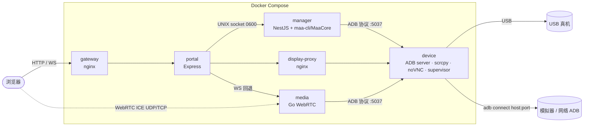

# 架构

## 容器拓扑

- **只有 `device` 容器接触设备。** 它运行唯一的 ADB 服务：USB 模式下独占 USB 设备，`tcp` 模式下只对配置的那个地址执行 `adb connect`。Manager 和 media 只通过 ADB 协议查询这个服务，不建立连接。
- **Manager 不监听 TCP。** API 只在权限 0600 的 UNIX socket 上提供，由 portal 转发；`maa-managerctl` 也走这个 socket。
- **portal 是浏览器面对的唯一后端**：校验 `Origin`（写请求还要求 `X-Maa-Request: 1` 与 JSON），签发 `__Host-` 控制 cookie，并按租约决定 noVNC/媒体是只读还是可输入。
- **执行与显示互不影响**：画面相关容器重启不会中断任务；Manager 重启会把进行中的运行标为中断，队列以暂停状态启动。

## 分层

服务端（`apps/server/src`）按依赖方向分为四层，内层不依赖外层的具体实现：

| 层 | 模块 | 职责 |
| --- | --- | --- |
| Domain | `maa-model/`（类型、默认值、各任务的编译规则、关卡开放规则、迁移）、`domain.ts`、`execution-plan.ts`、`account-safety.ts`、`device-policy.js` | 纯函数：任务校验、Windows GUI 配置 → Core 参数、调度时间、设备配置与绑定规则。没有 I/O，直接单元测试 |
| Application | `engine.ts`（队列、派发、运行生命周期）、`sequence.ts`（多文档顺序执行与账号确认）、`automation/`、`public-api/service.ts` + `daily-status.ts` | 用例编排：入队 → 编译 → 执行 → 记录；Bot API 的只读查询 |
| Infrastructure | `device.ts`（`AdbDeviceAdapter`）、`store.ts`（预设文件 + Prisma/SQLite）、`maa-runtime.ts`、`stage-activity.ts`、`mall-history.ts`、`core-log-identity-probe.ts`、`sanity.ts`、`usb-sysfs.js`、`sequence-main.ts` | ADB、文件系统、数据库、MAA API、maa-cli 子进程 |
| Presentation | `main.ts`（REST + SSE）、`public-api/http.ts`、`portal.ts`、`apps/web`、`apps/media` | HTTP 入口、浏览器界面、画面服务 |

`time-zone.ts` 与 `config.ts` 是唯一读取环境变量的地方；其他模块通过 `cfg` 或显式参数获得配置。

## 一次运行的数据流

1. **入队**：手动或调度触发 `Engine.enqueue`。读取预设文件，校验 JSON，并预编译一次以尽早发现错误。数据库记录运行快照（预设原文 + 哈希）与“仅本次”覆盖项。
2. **派发**：队列未暂停、设备已绑定且没有其他运行时，取最早的排队项。用派发时刻的时钟、活动关卡数据和基建计划重新编译（`maa-model.compilePreset`）：Windows 模式的任务按 MAA Windows v6.21.4 的序列化规则生成 Core 参数，原始 JSON 任务原样下发。编译报告写在运行日志开头。
3. **执行**：唤醒并解锁设备（`DevicePort.prepare`），写出私有快照文件，以固定参数数组启动 `maa run <快照> --addr <设备> --batch -v`（带账号切换的预设经 `sequence-main` 逐个文件执行；需要信用商店回调时使用 `-vvv` 并过滤日志）。日志按字节偏移追加，通过 SSE 推送。
4. **收尾**：根据退出码、Core 日志中的账号确认结果、前台应用等判定状态和原因；记录信用商店“每日一次”的完成情况和学到的剩余理智关卡。

## 关键契约与替换点

| 契约 | 默认实现 | 替换方式 |
| --- | --- | --- |
| `DevicePort`（`device.ts`） | `AdbDeviceAdapter`：通过 ADB 服务访问 `devices.json` 指定的设备 | 测试中注入 Fake；新的连接方式实现同一接口，并在 `main.ts` 的 provider 中切换 |
| 设备配置与绑定规则（`device-policy.js`） | USB serial / `host:port` | Manager、supervisor 共用同一模块；media 中有 Go 实现，由契约测试保持一致 |
| `DeviceCommand` | `execFile` 调用 `ADB_BIN` | 测试中注入，记录参数而不执行 |
| maa-cli | `MAA_BIN`（`/opt/maa/bin/maa`） | 测试使用 `scripts/fake-maa.sh` 或预加载的 Node 假进程 |
| 活动关卡数据 | `StageActivityFetcher` 访问 `MAA_API_URLS` | `off` 关闭；或用 `MAA_STAGE_ACTIVITY_FILE` 指向本地文件 |
| 剩余理智关卡存储 | `FileSanityStageStore` | 实现 `SanityStagePort` |
| Bot API | `public-api/` | 契约见 `contracts/bot-daily-api.openapi.json`，独立于控制台 API |

`auth/`、`workspace/`、`lease/` 与 `automation/` 中的 HTTP/仓储部分是早期多用户方案留下的模块，当前版本没有接入 `main.ts`（`automation/recovery.ts` 除外），数据库中对应的表也未使用。

## 设计约束

- 单设备、单任务串行；同一时刻只有一个 MAA 进程操作设备。
- 运行前编译、运行时使用快照：运行中修改预设不会影响已经开始的运行。
- 失败时保持关闭：设备配置无效、时区无效、无法确认账号（`require-verified`）时拒绝运行，而不是猜测。
- 不提供任意命令执行接口；所有外部进程都使用固定可执行文件路径与参数数组。
- 文件读取都有大小上限，写入使用临时文件 + 原子重命名。
